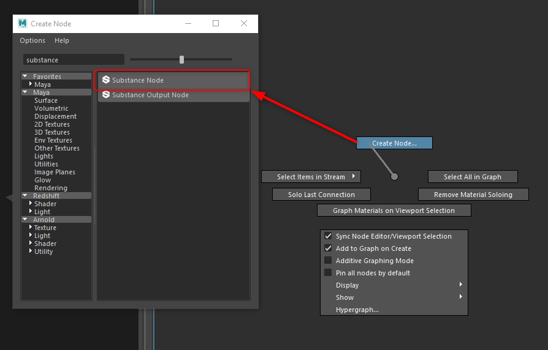

# Substance in Maya Overview

## Plugin Overview

The Substance for Maya plug-in allows you to load any existing Substance 3D material (.SBSAR file) directly in Maya. Substance 3D materials can be authored and exported as SBSAR files from Substance 3D Designer or Substance 3D Sampler, and downloaded from existing libraries such as the Substance 3D Assets library. The Substance for Maya plug-in creates Maya materials and feeds the output textures into the correct material channel inputs

>[!NOTE]
>
> Make sure you have the plugin loaded in the Settings/Preferences -&gt;Maya Plug-in Manager

## Opening a SBSAR file in Hypershade Node Editor

1. Open **Hypershade** and in the **Node Editor**, right-click and swipe up in the marking menu to choose **Create node**. From the **Create Node window**, search for and select the **Substance node**.

   

   Click on the **Substance node** in Hypershade to select it. This will open the **Material Editor**, where you can load your Substance 3D material (SBSAR file) by clicking the folder icon.

1. Alternatively, you can drag and drop an SBSAR file into Maya's **Hypershade Editor**, and click on the Substance node automatically created to directly view and edit options in the **Material Editor**.

### Play with SBSAR parameters in the Property Editor

1. The **Selected Graph drop-down** populates if the Substance contains multiple graphs. Select which graph to use to create the material.

1. The **Graph Info button** displays the graph attributes set in Substance Designer.

1. Set the Resolution by setting **Width** and **Height** values. Disable **Lock Ratio** to choose non-square ratios.

1. Enable **Cache Outputs to Disk** to bake the Substance Outputs to disk so they can be used with renderers such as Arnold. The cached file will be read back in by the plugin using a Maya file node.

   

1. Choose a workflow for the renderer you are using and click the **Create Shader Network button**. A shader network is created for the renderer workflow. For versions 3.1.1., the list of workflows also offers the option to create OpenPBR shader networks. Once the shader network is created, you can apply the material in the scene.

   {width="1000px"}

## Troubleshooting

To report a bug, please join the #maya-plugin channel on the [Substance Discord server](https://discord.com/invite/substance3d) or visit [Adobe communities](https://community.adobe.com/t5/substance-3d-plugins/ct-p/ct-substance-3d-plugins?page=1&sort=latest_replies&lang=all&tabid=all&topics=label-autodesk3dsmax). Including relevant information from the console log and any reproduction steps will help us diagnose the issue more efficiently.