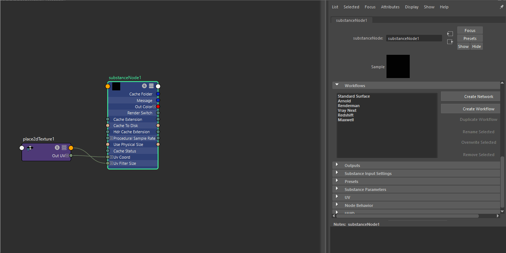

# Using Workflows

Under Workflows, you can choose or create render presets for Substance outputs. These presets are shader networks for a renderer such as Arnold or Vray.

>[!NOTE]
>
> **Workflow Preset Locations**
>
> **Windows**:
> C:\Users\\Documents\maya\2022\substance\workflows\generated
> **MacOS**:
> /Users//Library/Preferences/Autodesk/maya//substance/workflows/generated
> **Linux**:
> /home//maya//substance/workflows/generated

To use a Workflow, simply choose the preset from the list and then click the Create Network button.

## Creating a Workflow

You can create your own workflow and add it to the Renderer Workflow list. When adding a new workflow, any nodes created after the Substance node will be saved in the workflow. This allows you to create any number of shading nodes to build a complete custom shader network that can be saved as a preset workflow.

## Managing Workflows

### Saving Custom Workflows

1. Manually create Substance outputs and connect them to a material such as aiStandardSurface.
   1. You can use any Maya or render specific nodes to build the shader network.
1. Click the **Create Workflow** button and enter a name for the workflow preset.

### Duplicating Workflows

You can duplicate a workflow by clicking the **Duplicate Workflow** button.

### Rename and Overwriting Workflows

You can rename existing workflows as well as overwrite workflows with updated data using the **Rename** and **Overwrite** selected buttons.

### Removing Workflows

You can remove existing workflows by using the Remove workflow button.

## OpenPBR Workflows

Two OpenPBR workflows are available in the Workflows list: **OpenPBR** and **OpenPBR - V-Ray**. These workflows are designed for use with SBSAR files authored using the OpenPBR material model in Substance 3D Designer or Sampler (OpenPBR has been the default model since Designer V16.0+ and Sampler V6.0+).

### What is OpenPBR

OpenPBR is an open, physically-based material shading model developed by Adobe and Autodesk and contributed to the Academy Software Foundation (ASWF). It provides a unified material definition compatible across renderers. For more information, visit the [OpenPBR documentation](https://experienceleague.adobe.com/en/docs/substance-3d/general-knowledge/openpbr/openpbr-overview).

### When to use an OpenPBR workflow

Use an OpenPBR workflow when your SBSAR file was authored using the OpenPBR material model in Substance 3D Designer or Substance 3D Sampler. If your SBSAR was authored using Adobe standard material model (ASM), use the legacy workflow compatible with your renderer (Arnold, V-Ray or V-Ray 6).

>[!NOTE]
>
> If you apply an OpenPBR workflow to an ASM material, or a standard workflow to an OpenPBR SBSAR, the plug-in will only connect outputs that are common to both material models. The result may be incomplete.

### Available OpenPBR workflows

**OpenPBR**

Uses the native Maya openPBRSurface node. Compatible with Arnold and V-Ray. This is the recommended workflow for most users working with OpenPBR materials in Maya.

**OpenPBR - V-Ray**

Uses the V-Ray material (VRayMtl) in OpenPBR mode. Recommended for users whose pipeline is specifically built around V-Ray material setups.

### How to apply an OpenPBR workflow

1. Load your SBSAR file into the plug-in using the Load Substance button.
1. In the Workflows list, select **OpenPBR** or **OpenPBR - V-Ray**.
1. Click **Create Network** to create the shader network in the **Hypershade Material Editor**.
1. The plug-in automatically connects the SBSAR outputs to the corresponding inputs of the OpenPBR node.
1. Assign the material to your mesh as usual.

